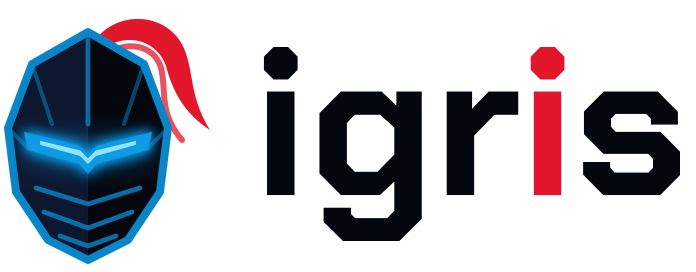
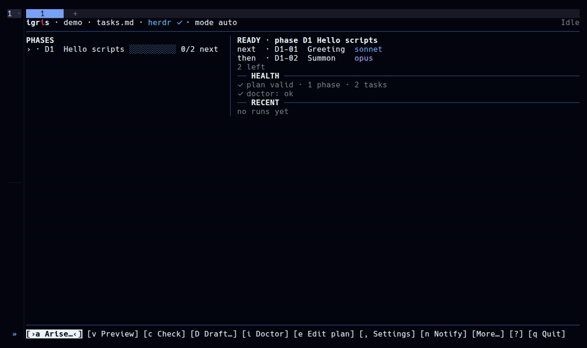
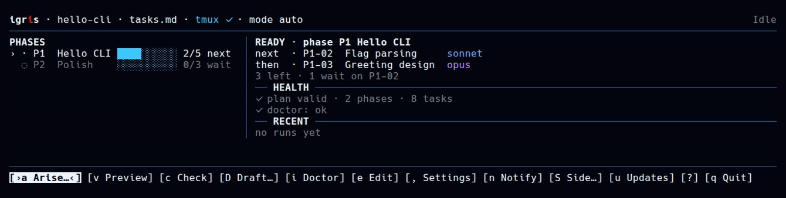

<h1 align="center">
  <picture>
    <source media="(prefers-color-scheme: dark)" srcset="docs/brand/igris-logo-dark.svg">
    
  </picture>
</h1>

<p align="center"><em>Arise.</em> One task, one fresh session, the right rank.</p>

<p align="center">
  <a href="https://github.com/drilonrecica/igris/actions/workflows/ci.yml"></a>
  <a href="https://github.com/drilonrecica/igris/releases/latest"></a>
  <a href="https://pkg.go.dev/github.com/drilonrecica/igris"></a>
  <a href="LICENSE"></a>
</p>

<p align="center"><strong><a href="https://drilonrecica.github.io/igris/">drilonrecica.github.io/igris</a></strong> · <a href="https://drilonrecica.github.io/igris/docs/">docs</a></p>

<p align="center"></p>

**igris** runs the tasks in your markdown project plan **one at a time**, each in a **fresh Claude Code session**, started with **exactly the model your plan assigns to that task**.

You write the plan and decide which tasks need Fable, which need Opus and which are fine on Sonnet. igris makes sure that's what happens: it never runs a Sonnet task on a more expensive model, never lets one task's context bleed into the next, and stops to wait for you whenever a task needs a decision.

> **Status:** v1.0.0, stable: what 1.x keeps stable is in [`docs/compatibility.md`](docs/compatibility.md). Linux and macOS, Windows through WSL2; runs in herdr or tmux. The full behavior is specified in [`SPEC.md`](SPEC.md).

**Contents:** [Why](#why) · [Quick start](#quick-start) · [Install](#install) · [Where igris runs](#where-igris-runs) · [Your plan](#your-plan) · [Running a phase](#running-a-phase) · [Verification and commits](#verification-and-commits) · [Worktree mode](#worktree-mode) · [Modes](#modes) · [Notifications](#notifications) · [Commands](#commands) · [The TUI](#the-tui) · [Security](#security) · [FAQ](#faq)

---

## Why

Long Claude Code sessions fill their context and drift. Picking the model by hand for every task is tedious and easy to get wrong, and the expensive mistake is the silent one: a routine task quietly running on your most expensive model.

If you already plan your work as a task table with dependencies and a model per task, igris turns that plan into an execution queue. `igris arise M0`:

1. Takes the first ready task in phase `M0`.
2. Opens a new pane and starts Claude Code with that task's model (`--model sonnet`, `opus`, `fable`, …).
3. Hands it the task, the plan and your project rules.
4. If Claude needs you (a decision, an approval, a plan to review), igris waits and notifies you.
5. When the task is truly done, Claude runs `igris done M0-03`. igris runs your checks if you set them, commits if you want, marks the task `done`, unblocks what depends on it and closes the session.
6. Starts a fresh session for the next task, until the phase is finished.

Strictly sequential. Deterministic. No LLM decides which model runs what.

### Shadows have ranks

Like summoning the right shadow for the fight, each task gets the rank your plan gives it:

| Rank (your plan) | Typical use | Claude Code model |
|---|---|---|
| `sonnet` | routine, well-specified work | `--model sonnet` |
| `opus` | complex or security-sensitive logic | `--model opus` |
| `fable` | the highest-stakes design and correctness work | `--model fable` |

The aliases are yours to change under `[models]` in `igris.toml`. Every key in that file is optional, unknown keys are rejected so typos don't go unnoticed, and secrets such as the ntfy token can be `env:VAR_NAME` references instead of being written in the file; [`examples/igris.toml`](examples/igris.toml) lists every key with its default.

## Quick start

```sh
brew install drilonrecica/tap/igris   # or see Install
cd your-project
igris init          # creates igris.toml and .igris/, ignores .igris/ in git, allows `igris done` for Claude
igris doctor        # is everything in place? one line per check, with the fix for each problem
igris check         # validates your plan
igris status        # phases and tasks: what's ready, what's blocked
igris arise M0      # runs phase M0 (inside a herdr pane or tmux)
```

Or run bare `igris` in a terminal: the [home screen](#home-screen) walks you through the same steps, from a new project to a run.

No plan yet? `igris init --example` writes an example one. A plan in another format? [`igris adapt`](#different-format-igris-adapt) converts it.

**The first time,** Claude Code asks whether you trust the project folder ("Is this a project you trust?"). igris can't answer that for you: the task waits, and after about 30 seconds igris shows **needs you: the agent is blocked**. Open the session (`o` in the TUI), answer once, and the task carries on. Later sessions in that folder don't ask again.

## Install

**Requirements**

- **Claude Code**, logged in with your subscription (Pro/Max) or however you normally use it. igris starts ordinary interactive sessions, so it uses your normal login and limits.
  > If `ANTHROPIC_API_KEY` is set in your environment, Claude Code bills the API instead of your subscription. igris warns you about this at start and asks you to confirm.
- **[herdr](https://herdr.dev) or [tmux](https://github.com/tmux/tmux) 3.2+.** Each session runs in a herdr tab or a tmux window, so everything survives disconnects and you can reconnect over SSH, even from your phone. See [Where igris runs](#where-igris-runs).
- **git** (recommended): igris can commit after each task and warns when the tree is dirty.
- Linux or macOS (amd64 or arm64). On Windows, use [WSL2](#windows-wsl2).

igris needs Claude Code 2.1.291 or later (tested with 2.1.294), herdr 0.9.1 and tmux 3.2 or later (tested with 3.7). `igris check` and `igris arise` warn when one of them is missing, older, or a newer major version; they never refuse to run because of it.

**Homebrew** (Linux and macOS):

```sh
brew install drilonrecica/tap/igris
```

**Go** (the version pinned in `go.mod` or newer; an older Go fetches it):

```sh
go install github.com/drilonrecica/igris/cmd/igris@latest
```

**A prebuilt binary** from the [Releases](https://github.com/drilonrecica/igris/releases) page: `igris_<version>_<os>_<arch>.tar.gz` for linux and darwin on amd64 and arm64. [Verify the download](#verifying-a-download), then put the binary on your `PATH`:

```sh
tar xzf igris_<version>_<os>_<arch>.tar.gz
install -m 755 igris ~/.local/bin/igris
igris version
```

### Verifying a download

From 0.6.0 every release is signed with the igris release key, an SSH key. OpenSSH 8.1 or later verifies it, on every Linux and macOS, with nothing else to install. Its public half is:

```
igris namespaces="file,git" ssh-ed25519 AAAAC3NzaC1lZDI1NTE5AAAAIOFweVw8An9/KLs+Po4SB3jP7G/N8AkqtC67FHi48Xj+
```

It is also in [`allowed_signers`](allowed_signers) at the root of this repository, and the release tags are signed with it. Download `checksums.txt` and `checksums.txt.sig` from the same release as your archive, fetch `allowed_signers` from the release's tag, check that it holds the key above, and verify:

```sh
curl -fsSLO https://raw.githubusercontent.com/drilonrecica/igris/v<version>/allowed_signers
ssh-keygen -Y verify -f allowed_signers -I igris -n file -s checksums.txt.sig < checksums.txt
sha256sum -c --ignore-missing checksums.txt    # macOS: shasum -a 256 -c --ignore-missing checksums.txt
```

The first command must print `Good "file" signature for igris`, and the second `OK` for your archive.

- The signature covers `checksums.txt`, which lists every archive and its SBOM (`<archive>.sbom.json`, SPDX JSON: the modules the binary is built from).
- In a clone, `git -c gpg.ssh.allowedSignersFile=allowed_signers verify-tag v<version>` checks the tag.
- Releases before 0.6.0 have checksums only: they guard against a corrupted download, not a replaced one.
- Homebrew checks each archive against the sha256 in its formula; `go install` checks modules against the Go checksum database.
- If the release key is ever replaced, the new key is announced in the CHANGELOG and here, and the old one stays in `allowed_signers` with a `valid-before` date, so older releases still verify.

### Shell completion

`igris completion bash|zsh|fish` prints a completion script for subcommands, flags, and phase and task IDs from your plan (the plan of the current directory; nothing is offered while it is invalid). After `igris report` it completes run IDs, newest first.

```sh
# bash: add to ~/.bashrc
source <(igris completion bash)

# zsh: add to ~/.zshrc, after compinit
source <(igris completion zsh)

# fish: install once
igris completion fish > ~/.config/fish/completions/igris.fish
```

## Where igris runs

`igris arise` runs inside **herdr** or **tmux**: sessions have to outlive igris and your connection. `igris init` writes `backend = "auto"`, which uses herdr inside a herdr pane and tmux inside tmux; set `backend = "herdr"` or `"tmux"` in `igris.toml` to pin one. Outside both, `igris arise` exits and says where to run it.

Only `arise` and `adapt` need a backend. `init`, `doctor`, `check`, `phases`, `status`, `history`, `report`, `done`, `skip`, `reset` and `notify test` run in any shell.

### herdr setup

igris starts every session in its own herdr tab, so `igris arise` must run **inside a herdr pane** with the herdr server running:

1. Install [herdr](https://herdr.dev) and start it (`herdr`), ideally on the machine where your project lives. Reconnect over SSH whenever you like; everything is still running.
2. Optional: `herdr integration install claude`, so herdr itself also shows Claude's state. igris doesn't need it: it reads the state from Claude Code hooks (see [How igris watches Claude](#how-igris-watches-claude)).
3. In a herdr pane, `cd` to your project and run igris.

### tmux setup

Each session opens in its own tmux window, in the background, named `<task> · <rank>`:

1. Install tmux 3.2 or newer and start it (`tmux`, or `tmux new -s work`). Detach with `ctrl+b d`; reattach later, also over SSH, with `tmux attach`.
2. In a tmux window, `cd` to your project and run igris.
3. Press `o` in igris (or `ctrl+b` and the window number) to switch to a session's window, and come back the same way.

igris's toasts show in tmux's status line; ntfy or Discord reach you when you're away. When a session's Claude Code exits, its window stays open (dead) so you can see why, until igris closes it.

An interrupted run resumed under the other backend can't reattach its session; igris then offers the usual choices (continue the conversation, start fresh, done, skip).

### Windows (WSL2)

igris doesn't run natively on Windows. It runs inside [WSL2](https://learn.microsoft.com/windows/wsl/install), like herdr and Claude Code:

1. Install WSL2 with a Linux distribution (Ubuntu is fine) and open it in Windows Terminal.
2. **Inside WSL**, install herdr, Claude Code and igris (the `linux_amd64` binary, or `linux_arm64` on ARM). Don't mix sides: an igris in WSL can't drive a Claude Code or herdr installed on Windows.
3. Keep the project in the Linux filesystem (`~/code/…`), not under `/mnt/c`. Files on the Windows drive are much slower from WSL, and Windows tools touching the same checkout (an IDE's git, `core.autocrlf`) make for surprising diffs. If your editor is on Windows, open the WSL folder through `\\wsl$\` or VS Code's WSL extension.

Plans and `igris.toml` saved by Windows editors work: CRLF line endings and a UTF-8 byte order mark are fine, and igris keeps both when it writes a Status cell. Windows Terminal supports the colors and mouse input the TUI uses.

So far WSL2 support has been tested by reproducing these conditions on Linux (`docs/check-wsl.md`), not on a real Windows machine. Reports, good or bad, are welcome in an issue.

## Your plan

A plan is a markdown file (default `tasks.md`) with one task table per `##` phase:

```markdown
## M0 — Repository foundation

| ID | Task | Deps | Status | Model | Owner |
|---|---|---|---|---|---|
| M0-01 | **Go module** — init module, pin Go version | — | ready | sonnet | agent |
| M0-02 | **Entrypoint** — main.go with subcommands | M0-01 | blocked | sonnet | agent |
| M0-03 | **Crypto envelope** — versioned secret format | M0-01 | blocked | opus | agent |
| M0-04 | **Create GitHub repo** | — | ready | — | user |
| M0-G | **M0 gate** — owner smoke test | M0-01…M0-04 | blocked | sonnet | agent + user |
```

| Column | Values | Notes |
|---|---|---|
| **ID** | e.g. `M0-01` | Unique across the plan. |
| **Task** | text, ideally starting with a `**bold**` title | What the session is told to do. |
| **Deps** | comma-separated IDs or ranges (`M0-01…M0-04`), across phases too | A column with another name (`Depends`, `Depends on`, …) needs an alias under `[columns]` (`"Depends" = "Deps"`); otherwise igris reads no dependencies from it, and `igris check` warns. |
| **Status** | `ready`, `blocked`, `in progress`, `done`, `skipped` | igris keeps this column up to date and touches nothing else in the file. |
| **Model** | a rank from `[models]` | The only input for the model. A task without a usable one is a validation error, not a guess. |
| **Owner** | `agent`, `agent + user`, `user` | `agent + user`: the agent must get your decision or sign-off. `user`: your own task (below). |
| **Mode** *(optional)* | a [mode](#modes) | Forces a mode for the task, e.g. `plan` for design-heavy tasks. |
| **Verify** *(optional)* | a verify profile, or `none` | See [Verification and commits](#verification-and-commits). `—` or empty falls back to the phase's and the project's default. It names profiles, never commands: a cell like `make test` fails `igris check` with a hint to define it under `[verify]`. |
| **Timeout** *(optional)* | a Go duration (`45m`, `1h30m`), at least `1s` | Past it, igris marks the task **overdue** and **Needs you**, logs and notifies `task_overdue`, once per session. It never stops the session. The clock starts with the first prompt (or a reattach); a retry starts a new one. |
| **Context** *(optional)* | up to 20 repo-relative paths, e.g. `` `docs/auth.md`, internal/auth/ `` | Listed under **Required reading** in the prompt (`.Context` in custom templates). igris names the paths and never reads or sends their contents. Each must exist inside the project: absolute paths, `..`, `.` (the whole project: list what to read instead), a file written with a trailing `/` and symlinks out of it fail `check` and `arise` (checked against the project root, or the working directory for `check`, `phases` and `status`). |

- On a `user` task, Verify, Timeout and Context are ignored, and `igris check` warns about each one that is set. These three cells are checked only on tasks that aren't `done` or `skipped`, and `igris status` shows their columns only when some task sets them.
- **User tasks** are yours to do outside igris. The card says **YOUR TURN — yours to do outside igris (no session). Then: d done · s skip**. Do the work wherever it happens, then press `d` (with an optional note, e.g. the name you picked, which lands in `igris history`) or `s` to skip with a reason. `igris done ID --note …` and `igris skip ID --reason …` work from any terminal too.
- **Blocked on something outside the plan?** (API keys from a client, a deploy, a date.) Add a `user` task that names the blocker and make the waiting task depend on it, e.g. `| X-00 | **Wait for API keys from client** | — | ready | — | user |`. igris notifies you when it's your turn and carries on once you mark it done. `igris adapt` turns prose like "waits on" or "blocked by deploy" into such a task.

The full format, with every rule and a larger example, is in [`docs/plan-format.md`](docs/plan-format.md); it is frozen for igris 1.x. A plan may declare it with `<!-- igris:format 1 -->` before its first `##` heading; without that line it is format 1 anyway.

A complete small plan is in [`examples/tasks.md`](examples/tasks.md), and a commented config in [`examples/igris.toml`](examples/igris.toml); copy them and run `igris check` and `igris arise P1 --dry-run` to see how igris reads them. [`examples/advanced/`](examples/advanced/) is the same plan with Verify profiles, Timeouts and Context paths, and the `igris.toml` that defines its profiles.

### Different format? `igris adapt`

`igris adapt` converts a plan igris can't read into the canonical format. It opens one Claude Code session (in herdr or tmux, mode default) with `adapt.model` from `igris.toml` (`sonnet` by default; `--model opus` for a hard one; `--plan PATH` for a plan other than the configured one). The session gets the format, `igris check`'s complaints, your `[models]` and the names of your verify profiles (never their commands), writes the converted copy to `.igris/adapt/<plan>.proposed.md`, and finishes with `igris done ADAPT`. It may ask you things in its pane, like any session.

It keeps every task, ID, description, dependency, status and model; it only restructures. It never invents models: a task without a usable one gets Model `?` and is listed under `## Adapt notes`, and `igris check` keeps rejecting it until you fill it in. Then igris opens a review of what the proposal changes, and nothing replaces your plan until you accept.

<details>
<summary>The adapt review in detail</summary>

- Verify, Timeout and Context cells are kept as written and never invented; a column of one of those names that holds something else (a command under Verify, say) is renamed so it stays an extra column, and noted.
- The review shows the `igris check` result and any problems on top. When your plan already has task tables, it compares them table by table (tasks by ID, cells by column name) and lists only what changed: added (`+`) and removed (`-`) phases, tasks and columns, one `~` line per changed cell (`M2-04 Deps: "M2-01" → "M2-01, M2-03"`), renamed columns or a new column order, then a line diff of the text outside the tables. Otherwise it is a line diff of the two files (`-` removed, `+` added, long unchanged stretches folded).
- Scroll with the arrow keys, `pgup`/`pgdn` or the wheel. **Reject** has the focus first, so `enter` changes nothing. `a` or **Accept** replaces your plan after backing it up to `.igris/adapt/<plan>.<timestamp>.bak.md`; `r`, `esc` or `q` reject (the proposal stays in `.igris/adapt/`).
- A proposal that doesn't pass `check` yet, e.g. with models left at `?`, asks once more before it replaces anything, and igris then lists what is left to fix. If the plan changed on disk while you reviewed, nothing is replaced.
- `adapt` can't run while `igris arise` runs in the project, and `Ctrl-C` stops waiting without closing the session.

</details>

## Running a phase

`igris arise M0` runs phase `M0`; `--through M2` continues through later phases. A run is strictly sequential, and only one `igris arise` runs per project at a time.

- **Preview first:** `igris arise M0 --dry-run` shows the launch order with each task's model, mode and verify profile (and whether task hooks would run), without starting anything or writing a byte.
- **Without the TUI:** `igris arise M0 --no-tui` prints plain log lines and reads your answers from stdin: `y`/`n`, `reset yes|no` for a reset request, `done [note]`, `skip <reason>`, `retry [continue|fresh]`, `pause`, `stop`, `mode [task] <m>`, `help`.
- **Resume:** quitting igris leaves the session running. `igris arise` with no phase picks up exactly where it left off: it reattaches to the running session, or, if that's gone, lets you continue its conversation or start a fresh session that is told to check the work already in the tree. `igris status` keeps showing that resume state (`Lock none`, the task it was on).
- **A stale lock:** if a crashed run left its lock behind, igris says so; `igris arise --force-unlock` clears it.
- **Before a run starts,** igris warns if `ANTHROPIC_API_KEY` is set (it asks you to confirm), if the project isn't a git repository, or if the tree has uncommitted changes. If `igris.toml` changed during the last run (a session can edit it; that run kept the configuration it started with), igris asks you to review and confirm the file before a run uses it.

### Part of a phase

Name the tasks: `igris arise --only M1-03,M1-05` runs just those, `--from M1-03` starts at a task and `--until M2-02` stops after one. `--from` and `--until` combine; `--only` doesn't combine with them.

- Without a phase, the range comes from the tasks you name (`--through` still sets the last phase); with one, every named task must lie inside it and `--through`.
- A wrong ID, a task outside the range or a `--from` after the `--until` stops `arise` before it asks or writes anything.
- Tasks still run in plan order and dependencies still count: a task that waits on unfinished work is reported as `not run: M1-05 waits on M1-04 (ready, phase M1)`, never marked, and the run goes on (that is not a stuck phase).
- An interrupted task from an earlier run is still picked up first, even outside the slice. A bare `igris arise` resumes the same slice, and `--dry-run` walks it.

### Done, skip and reset

`igris done ID [--note TEXT]` and `igris skip ID --reason TEXT` work from anywhere inside the project. They only drop a signal file in `.igris/signals/`; the running `igris arise` applies it.

- A signal for a task that isn't the current one is kept and shown, never applied.
- A `skip` from an agent session is only a request: igris asks you to confirm it. `igris init` allows `igris done` for Claude, never `igris skip`, so a session that wants to skip has to ask you.
- If you mark a task done yourself, igris takes your word and skips verify.

`igris reset ID [--force]` puts a task back to `ready` (or `blocked`, if a dependency is unfinished), e.g. to run it again. It works on a task `in progress`, and with `--force` on a `done` or `skipped` one. User tasks work the same way.

<details>
<summary>How reset works with and without a running igris</summary>

- **No igris running:** it rewrites the Status cell itself (and any `ready`/`blocked` cells that follow from it) and says so: `M1-03: in progress → ready`. If that task was the one an interrupted run was working on, close its session by hand.
- **igris running here:** it hands the reset to that run as a request (`M1-03: reset requested; confirm it in the running igris`). The run asks you **Reset M1-03?** (with `--no-tui`, type `reset yes` or `reset no`), because a session could write the same request, and applies it only once you confirm, never in the middle of a verify or a commit. A reset requested while the task is being verified or committed is answered before the task is accepted, so it's never lost behind its done. A request still waiting when igris stops is asked about at the next `igris arise`.
- Resetting the task igris is working on closes its session and turns **pause after task** on, so it doesn't just start again; press `p` to continue.
- A run on another host can't be reached: reset there, or clear its lock with `igris arise --force-unlock`.
- Tasks in progress that depend on the reset one are listed and left as they are. The run log gets a `task_reset` entry.

</details>

### What a session is told

Each session gets two prompts: fixed igris rules (one task only, never touch Status, run `igris done` last) passed as a system-prompt file, and a first message built from a template. Set `prompt_template` in `igris.toml` to your own Go template to replace the message; the variables are listed in SPEC §6.1.

### How igris watches Claude

igris starts every session with `--settings .igris/hooks/<task>.settings.json`, a Claude Code settings file that contains only hooks (in [worktree mode](#worktree-mode) also the `igris done` rule your project allows, and reading the plan).

The hooks run the hidden `igris hook` command on Claude's lifecycle events (prompt submitted, tool use, permission prompt or question, turn finished, session ended), which records the session's state in `.igris/agent-state/`. That is how igris knows a session is working, waiting for you or idle, without screen-scraping, in tmux and in herdr. Nothing is added to your `.claude/` settings, and your own Claude sessions are unaffected.

- **Waiting on background work is not "needs you".** When Claude ends its turn while a background task (tests on a simulator, a long build) or a scheduled wakeup is pending, the card says `waiting on background work` and igris doesn't bother you: Claude Code picks the session up again when that work is done. Only after `waiting_limit` (default `30m`) does it count as **Needs you**. With herdr's integration installed, herdr's own state wins, except for this: the hooks know when a finished turn still has work running.
- **One reminder.** When Claude stops without `igris done` and nothing is pending, igris first reminds it once (finish with `igris done`, or say what it waits for). If it stays idle another `needs_input_after` (default `30s`), you get **Needs you**. `nudge = false` turns the reminder off.
- **The state only drives Needs you;** a task still advances only on `igris done` or your action. One exception: if a session sits idle 15 s after igris sent its first prompt and the hooks show the prompt was never submitted (it's still pasted in Claude Code's input box), igris presses Enter in the pane once and says so in the feed.
- **Token usage** (since 1.1). The hooks also report where Claude Code keeps the session's transcript. About every 10 seconds, and once when the attempt ends, igris reads from it (and from its subagents' files next to it) the token counts and model ids, never the messages. It logs each attempt's totals in `runs.jsonl` as a `usage` line. These are the tokens recorded in the transcripts, not a bill: igris never prices them. If it can't read the transcript, it says so once in the feed and logs the usage as `unavailable`; the task goes on. `[usage] enabled = false` turns this off. A session could forge its own transcript; see the [threat model](docs/threat-model.md).

## Verification and commits

Set `verify` under `[run]` in `igris.toml` (e.g. `verify = "make fmt lint test"`) and igris runs it each time a session says it's done. Different tasks can verify differently with **verify profiles**: name shell commands under `[verify]`, give a phase its own default with `[phases.<id>]`, and pick one per task with the plan's `Verify` column:

```toml
[run]
verify = "make fmt lint test"        # the profile "default"

[verify]
fast = "go test ./internal/plan/..."

[phases.M0]
verify = "fast"                      # or "none": no verification for this phase's tasks
```

- **Which profile:** the task's Verify cell, else `[phases.<id>] verify`, else `default`; `none` at either of the first two levels turns verification off, and with nothing set there is none. `igris arise --dry-run` shows each task's profile.
- **When it fails,** the last 60 lines of output (at most 16 KiB, escape sequences stripped) go back into the same session to fix. After `verify_max_attempts` (default 3) failures in a row igris calls you instead. The failure sent back names the profile. `verify_timeout` (default `15m`) and `verify_max_attempts` apply to every profile and belong under `[run]`; written under `[verify]` they are an error, not profiles.
- **Names:** profile names use `a-z`, `0-9`, `_` and `-`; `none` is reserved, and `run.verify` together with `[verify] default` is an error. A Verify cell naming an unknown profile fails `igris check` and `igris arise`; a `[phases.<id>]` naming no phase of the plan is a warning.
- **Keep in mind** that verify runs your project's own code, as you: a session that can edit files can change what it does.

**Commits:** after a task passes, igris commits everything in the tree. `commit = "ask"` (the default) asks you first, `auto` just commits, `never` leaves git alone. The message comes from `commit_message`, `{{.ID}}: {{.Title}}` by default, with the session's done note as the body.

### What verify and hooks see

Verify commands, task hooks and git (a commit runs your git hooks) never get the environment variables your notification secrets come from: with `token = "env:NTFY_TOKEN"`, `NTFY_TOKEN` is left out, since a session writes the code verify runs and sees its output. Everything else in igris's environment is passed, unless you list what verify and task hooks may see:

```toml
[run]
env = ["GOPATH", "LANG", "LC_*"]     # PATH and HOME are always passed; a trailing * is a prefix
```

`env` doesn't limit git, whose hooks and commit signing need variables like `SSH_AUTH_SOCK` or `GPG_TTY`.

### Task hooks

`[hooks]` runs your own commands around every agent session, for example to start a dev database before a task and report its result after:

```toml
[hooks]
before_task = ["./scripts/dev-db", "up"]   # argv list: no shell, no globbing, no pipes
after_task = ["./scripts/post-status"]
timeout = "2m"                             # per hook run, the default
```

Hooks run where the sessions do (the project root, or the run's [worktree](#worktree-mode)), with the environment [verify gets](#what-verify-and-hooks-see) plus `IGRIS_TASK_ID`, `IGRIS_PHASE`, `IGRIS_RANK` (the plan's rank), `IGRIS_MODEL` (the resolved `--model` value) and, for `after_task`, `IGRIS_RESULT` (`done` or `skipped`). They run for agent tasks only, never for user tasks or `adapt`, and `--dry-run` only says they would run.

- **`before_task`** runs after the task is marked `in progress` and before its pane opens, for every session igris opens (a retry too), but not when igris reattaches to a live session. If it fails (non-zero exit, timeout, or it can't be started), no session is opened: the task stays `in progress`, igris shows **Needs you** and sends `run_error`, and you choose to retry (which runs the hook again), mark the task done, skip it, or stop.
- **`after_task`** runs once the task is marked `done` or `skipped` and its session is closed. A failure is a warning plus a `run_error` notification; the run goes on. It doesn't run for a task you reset, or one a stop leaves `in progress`.

<details>
<summary>Hook output, failures and limits</summary>

- The log shows when each hook starts. A hook passes when it exits 0, also if it leaves a helper running in the background; igris waits up to 2 s for the hook's output to close and drops what the helper prints after that, so redirect a background helper's output.
- On a failure the log (TUI and `--no-tui`) shows the last 20 lines of the hook's output, escape sequences stripped. The run log and notifications only get the short reason, such as `before_task hook failed: exit status 1` (or `timed out after 2m`, `not found`, `killed by signal 9 (killed)`, `can't start it`), never the command line.
- An empty list means no hook; the first element is the program, and no element may contain a control character.

</details>

## Worktree mode

`igris arise P1 --worktree` (or `worktree = true` under `[run]`) runs the run in a git worktree on a branch of its own, so your checkout and your current branch stay as they are, and you can keep working in them. It is the safe way to leave a run in `auto` or skip-permissions mode unattended: whatever the sessions do lands on a branch you can review, merge or throw away.

- igris makes `.igris/worktrees/<run-id>` on a new branch `igris/<run-id>` from `HEAD`. Sessions, verify, task hooks and commits run there. Uncommitted changes in your checkout are not in it.
- The plan stays in your checkout: igris updates its Status cells there as usual, so `igris status` and the home screen show the run, and a plan that git ignores works too. The branch holds the sessions' work only. Context files must be committed for the worktree to have them.
- A session's `igris done` reaches the run from inside the worktree. It runs without a prompt when your project allows it (`igris init` adds the rule to `.claude/settings.local.json`; igris gives the worktree session that rule, nothing more), and the session may read the plan. Claude Code trusts the worktree once it trusts your project.
- An interrupted run continues in its worktree: plain `igris arise` picks it up, with or without `--worktree`.
- **igris never merges.** When the run completes with nothing uncommitted, it removes the worktree, keeps the branch and tells you: `the run's work is on branch igris/20261014-100518-7c5d; igris doesn't merge it: git merge igris/20261014-100518-7c5d`. Review it with `git log -p main..igris/<run-id>`, then merge it, or drop it with `git branch -D igris/<run-id>`. A worktree with uncommitted changes is kept (`git worktree remove .igris/worktrees/<run-id>` when you're done with it).
- `igris arise --dry-run --worktree` shows where the run would work. A fresh worktree has no build caches or `node_modules`, so the first verify may take longer.

## Modes

Choose the permission mode in the TUI, per run or per task: `m` (or **Mode**) for the run, or select a task and press `M` (**Task mode**) to override it for that task. A change applies to the next session; a running one keeps its mode. User tasks have no session, so they have no mode.

A task's mode is, in order: your override, its `Mode` column, the run mode (`--mode`), then `default_mode` in `igris.toml` (`auto` unless you set it; `default_mode = "default"` gets you every permission prompt).

| Mode | What it does |
|---|---|
| Default | Your normal Claude Code permission prompts. |
| Accept edits | Edits are accepted automatically. Bash commands still ask, even read-only ones (that is Claude Code's behavior), so igris shows "needs you" when one comes up. |
| Auto | Claude Code approves routine actions itself and asks you about risky ones. |
| Plan | Claude plans first; you approve the plan, then it implements. In the TUI the plan opens in igris too (below). `plan:default`, `plan:accept`, `plan:auto` and `plan:yolo` name the mode it continues in once you approve there; plain `plan` uses `[plan_mode] then`. |
| Skip permissions | `--dangerously-skip-permissions`. Never a single click or key: you type `skip permissions` to confirm, every run, and a red badge shows while it's active. Use it in a container you trust, or with [worktree mode](#worktree-mode). `plan:yolo` needs the same confirmation: its session starts in plan mode with `--allow-dangerously-skip-permissions` (Claude Code ignores the switch to skip permissions without it) and shows the badge from the start. |

**Approving plans in igris** (since 1.1). When a plan-mode session presents its plan, igris shows it in a dialog and marks the task **needs you**: **Approve** (the session switches to the mode its Mode names, `plan:accept` say, or for plain `plan` to the one `[plan_mode] then` names, `auto` unless you set `default` or `accept`), **Reject with feedback** (Claude revises the plan and presents it again) or **Answer in the pane** (opens the session). Claude Code's own plan dialog stays open in the pane meanwhile; whichever you answer first wins. igris keeps every plan presented under `.igris/plans/`, logs each one (the file and a hash, never the text), and adds the approved plan to the commit body. If you don't answer within `[plan_mode] approve_timeout` (30 minutes by default; `"0"` turns this off), or igris stops, the plan waits in the pane. Not with `--no-tui`. A session could forge an approval of its own plan (it can write `.igris/` like everything else in the project), but never pick the mode it switches to; see the [threat model](docs/threat-model.md).

`claude.extra_args` can't carry flags that change the session's model, mode, permissions, tools, directory or system prompt (`--model`, `--permission-mode`, `--settings`, `--allowedTools`, `--add-dir`, `--bare`, `-c`/`-r`/`-w`, …; the full list is in SPEC §7.4): igris sets what it needs itself and rejects a config that has them. igris always starts `claude` from your `PATH`. The old `claude.command` key was removed in 0.7; every `igris.toml` that `igris init` wrote before then has it, and `igris config migrate` deletes it.

## Notifications

igris tells you when it needs you (a question, a plan to approve, a stalled session, a task past its Timeout), when a phase is done or stuck, and when something fails. Add `task_done` to a channel's `events` to hear about every finished agent task too. Channels:

- herdr toasts, or a tmux status-line message
- [ntfy](https://ntfy.sh) push to your phone
- Discord webhook
- Slack incoming webhook
- [Gotify](https://gotify.net) push from your own server
- a generic webhook: a signed JSON POST to any URL, for your own automation

```toml
[notify.ntfy]
topic = "my-igris-topic"          # leave empty to turn ntfy off
token = "env:NTFY_TOKEN"          # optional

[notify.discord]
webhook_url = "env:IGRIS_DISCORD_WEBHOOK"   # https only, as Discord gives it
events = ["needs_input", "phase_done"]   # default: needs_input, session_lost, task_overdue, phase_done, phase_stuck, run_error, verify_failed_limit

[notify.slack]
webhook_url = "env:IGRIS_SLACK_WEBHOOK"     # https only

[notify.gotify]
server = "https://gotify.example.org"
token = "env:GOTIFY_TOKEN"        # an application token; server and token go together

[notify.webhook]
url = "env:IGRIS_WEBHOOK_URL"     # http or https
secret = "env:IGRIS_WEBHOOK_SECRET"   # optional: signs the body
```

Check your setup with `igris notify test`: it sends a sample of each event to every configured channel (the herdr or tmux toast too, when run inside one) and prints `ok` or the reason for each failure. `--event needs_input` sends just one (and says so when no channel sends that event).

> On a public ntfy server without a token (such as ntfy.sh), the topic is the password: anyone who knows it can read your notifications and send fake ones. Pick a long random topic, or set a `token`. Home's Settings page shows the topic.

- **What's in a message:** the project, phase, task ID and title and the event; never file contents, diffs or command output.
- **Secrets** (the ntfy and Gotify tokens, the Discord, Slack and webhook URLs, the webhook secret) can be `env:VAR_NAME` references, are never logged, and are scrubbed from error messages.
- **Delivery:** each channel has a 10 s timeout and one retry; a channel that fails is shown as a warning and never stops the run. igris doesn't follow redirects (a `3xx` is reported as a failure: set the final URL), and a failure says only what went wrong (`connection refused`, `TLS failed`, `server answered 403 Forbidden`, …), never the URL.
- **Plain `http://`** works for ntfy, Gotify and the webhook (a server on your LAN), with a warning from `igris check` where a token or the payload would go unencrypted.
- **Priorities:** ntfy sends urgent events (`needs_input`, `session_lost`, `task_overdue`) at high priority; Gotify sends them at priority 8, `task_done` at 3 and everything else at 5.
- **Escaping:** Slack messages have `&`, `<` and `>` escaped, so a task title can't ping `@channel` or add links; Discord messages have `[` and `]` escaped, so a title can't make a masked link.

<details>
<summary>The webhook payload and its signature</summary>

The webhook POSTs JSON with every key present (`""` when unknown): `{"v":1,"event","project","phase","task","title","what","run","at","urgent","text"}`, where `run` is the run ID, `at` an RFC 3339 UTC time and `text` the message as other channels show it. The event is also in the `X-Igris-Event` header. With a `secret`, `X-Igris-Signature: sha256=<hex>` is the HMAC-SHA256 of the raw body with the secret; check it before trusting the payload. A valid signature can still be an old payload sent again by anyone who saw it (a plain `http://` hop, a proxy's or your own logs): treat `run` + `at` (or the whole body) as a dedupe key, and reject an `at` older than a few minutes.

</details>

### Templates, quiet hours and digests

```toml
[notify]
quiet = "22:00-07:00"             # local time, may cross midnight; "" (the default) is off
break_through = ["needs_input", "session_lost", "task_overdue"]   # the default: never held
task_done_digest = 5              # 0 (default): one task_done message per task; N: one per N tasks; "phase": one per phase

[notify.ntfy]
topic = "my-igris-topic"
template = "{{.At.Format \"15:04\"}} {{.TaskID}} {{.What}}"
```

- **Templates.** Every channel but the toast takes a `template` (Go `text/template`) that replaces the message text: the ntfy body, the Discord `content` and the Slack `text` (both still escaped), the Gotify `message`, the webhook's `text`. The variables are `.Event`, `.Project`, `.Phase`, `.TaskID`, `.Title`, `.What`, `.RunID` and `.At` (local time), nothing else; `if`/`else` and `with` work, loops and template calls (`range`, `define`, `template`, `block`) don't. A template is tried on a sample message when `igris.toml` loads, so a typo is a config error that names the channel, not a silent failure at night. Output is cleaned of control characters and cut to the channel's limit; an empty result falls back to the default text.
- **Quiet hours.** During the window, messages to ntfy, Discord, Slack, Gotify and the webhook are held, except the `break_through` events (`[]` holds everything); the herdr or tmux toast is never held. When the window ends, each channel gets one digest.
- **Digests of finished tasks.** With `task_done_digest`, a channel's `task_done` messages are collected and sent as one, `3 tasks done: M1-01, M1-02, M1-03`, when N are collected, when the phase ends (before its `phase_done`) and when the run stops. Templates apply to it, and in quiet hours it is held like any `task_done`.

<details>
<summary>Quiet-hours digests in detail</summary>

- igris checks the window at every poll, also while it waits on your answer.
- The digest reads `quiet hours 22:00–07:00: N held`, then a line `HH:MM <event>: <text>` per held message (at most 20, then `… and K more`; templates don't apply to it).
- Whatever is still held when the run stops is sent as a digest then (one attempt, at most 15 s in all; a second `Ctrl-C` exits at once).
- The webhook sends a digest as `"event":"digest"` with a `messages` array of the held payloads (at most 50) and `truncated`, the number left out.
- `igris notify test` ignores quiet hours and `task_done_digest`. The run log (`runs.jsonl`) records held messages and digests.

</details>

## Commands

| Command | What it does |
|---|---|
| `igris` | On a terminal: the [home screen](#home-screen). Piped or scripted: the help, exit 2. |
| `igris init [--example]` | Creates `igris.toml` and `.igris/`, ignores `.igris/` in git, allows `igris done` for Claude. `--example` also writes the example plan. |
| `igris doctor [--json]` | Read-only health check of the machine and the project. |
| `igris check [--strict]` | Validates the plan; `--strict` also lints it, for CI. |
| `igris phases` / `igris status [PHASE]` | Task counts per phase, with each phase's critical path, width and the tasks that could run together (also shown by `arise --dry-run`; igris itself still runs one task at a time) / tasks with rank, owner and what each waits on, plus the current run. |
| `igris arise [PHASE]` | Runs (or resumes) a phase; see [Running a phase](#running-a-phase). |
| `igris done` / `skip` / `reset` | Signal a task done or skipped, or put it back; see [Done, skip and reset](#done-skip-and-reset). |
| `igris history [TASK-ID]` | Past runs, or every attempt of one task. |
| `igris report [RUN]` | One run as markdown, for a PR description. |
| `igris notify test [--event NAME]` | Sends a sample of each notification to your channels. |
| `igris config migrate [--yes]` | Removes deprecated settings from `igris.toml`: shows the lines, asks, keeps a backup in `.igris/config/`. Run it after upgrading. |
| `igris adapt` | Converts a plan in another format; see [`igris adapt`](#different-format-igris-adapt). |
| `igris completion bash\|zsh\|fish` | Prints a shell completion script. |
| `igris help [COMMAND]` | The help, or one command's (`igris COMMAND -h` is the same). |
| `igris version` | Prints the version (`-v` and `--version` too). |

`check`, `phases` and `status` take `--plan PATH` (default: `plan` in `igris.toml`, else `tasks.md`), and they, `doctor`, `history` and `report` take `--json`. Each `--json` output is one object starting with `"v": 1`; its schema is in [`docs/json/`](docs/json/), and fields may be added but never removed or changed in 1.x. `igris <command> -h` lists a command's flags.

**Exit codes**: `0` success (also when you stop a run or an adapt), `1` failure, `2` usage error (an unknown flag, a missing or malformed argument). `3`–`9` are reserved, so test for non-zero rather than for `1`. What exits `1` for each command is listed in [SPEC §14](SPEC.md#14-cli).

`igris init` is safe to re-run: it never overwrites an existing `igris.toml`, appends to `.gitignore` only if `.igris/` isn't ignored yet, and merges its two `igris done` allow rules (`Bash(igris done:*)`, `Bash(igris done *)`) into `.claude/settings.local.json` without touching your other settings. `--example` writes the example plan only when there is none (it prints `kept tasks.md` and leaves an existing plan alone).

`arise`, `adapt` and `notify test` find the nearest `igris.toml` or `.igris/` upward; a folder with neither works only if it has your plan (`tasks.md`, or `adapt --plan`), otherwise igris asks you to run `igris init` and creates nothing.

<details>
<summary><code>igris check</code>, <code>phases</code> and <code>status</code></summary>

They read your plan without changing it.

- **`check`** exits 0 for a valid plan, 1 for an invalid one (2 on a usage error), and warns when `ready`/`blocked` cells don't match the dependencies, when `ANTHROPIC_API_KEY` is set, and when you run it from a subfolder of a project (it reads `igris.toml` only from the current folder).
- **`check --strict`** also lints the plan and exits 1 on any plan or config warning, which suits CI:
  - a Task cell without a `**bold**` title, or longer than 400 characters;
  - an `agent + user` row that never says what the owner does;
  - a `-G` gate task that doesn't depend on every other task of its phase (tasks after the gate that depend on it don't count);
  - a `yolo` or `plan:yolo` Mode cell;
  - a `fable` task that is the only heavy-rank (opus or fable) task of its phase.

  Done and skipped tasks aren't linted. Drift, ignored columns and config warnings fail it too; machine warnings (Claude Code or backend versions, `ANTHROPIC_API_KEY`, an `igris.toml` in a parent folder) are printed but never do, so it runs without Claude Code installed. With `--json` the document gets `"strict": true` and each lint warning a `"lint"` name. Plain `check` never shows these hints.
- **`phases`** lists task counts per phase.
- **`status [PHASE]`** lists tasks with rank, owner and what each is waiting on, under a short "Run" block (phases, the slice of an `--only`/`--from`/`--until` run, current task, mode, since, session, lock, pending signals) when a run exists in the project (`--json`: a `run` object, absent when there is none, with `selection` for a sliced run). The run is read from `.igris/` of the project root found upward from the current folder; an unreadable `state.json` is reported there, not as a failure. A task's duration includes the time it waited for you, so it isn't a measure of agent time.

</details>

<details>
<summary><code>igris doctor</code></summary>

`igris doctor` checks the machine and the project without changing anything: it never writes or creates `.igris/`, and has no `--fix`. It checks:

- Claude Code, the backend (herdr or tmux: version, whether igris runs inside it) and `ANTHROPIC_API_KEY`;
- git, `igris.toml` and the plan (every problem);
- the `igris done` allow rules in `.claude/settings.local.json` (or `.claude/settings.json`), with a warning if a rule there allows `igris skip` or every shell command, or `permissions.defaultMode` bypasses prompts;
- the modes of `.igris/`, a stale or foreign lock, a project under `/mnt/` (WSL);
- whether a notification channel is set up (nothing is sent; `igris notify test` sends).

Each line is `ok`, `warn` or `fail`; a problem is followed by the command that fixes it. It exits 1 only if some check is `fail`, works outside a project, and `--json` prints them as one object (`{"v": 1, "checks": [...]}`). Not running inside herdr or tmux is a `warn` here, since you usually run `doctor` from a plain shell.

</details>

<details>
<summary><code>igris history</code> and <code>igris report</code></summary>

**`igris history [TASK-ID] [-n N] [--json]`** lists the last N runs (default 10, newest first) from `.igris/runs.jsonl`: phases, tasks done and skipped, how long each task took, verify attempts, commits and how the run ended (`completed`, `stuck`, `stopped`, `error`, or `interrupted` when it has no stop event). Each run shows its run ID (e.g. `20261008-091500-3fa2`) when the log has one (`"run"` in `--json`). With a task ID it lists every attempt of that task across all runs.

**`igris report [RUN] [--json]`** prints one run as markdown, to paste into a PR description or a journal:

- the run's ID, start, end and how it ended, its phases and slice, the counts (done, skipped, unfinished, commits) and how long igris waited on you (*needs you*);
- per phase, a table with each task's result, duration, attempts (retries and resumes count), verify results (`fast ✗ ✓`: the profile, one ✗ per failure, ✓ per pass), short commit SHA and needs-you time;
- the done notes and skip reasons, and a `claude --resume <uuid>` line per agent session you can reopen (run it in the project root).

`RUN` is `1` (the newest run, the default), `2` for the one before, and so on, or a run ID from `igris history`. Needs-you time counts only while igris waited on you: an idle wait ends when the session runs `igris done`, and an overdue task or the verify limit stops counting once the agent works again. Text from the log is escaped in the markdown, so a task title or note can't add links or formatting. `--json` prints the same as one object. It exits 1 when there is no such run, and 2 when `RUN` is neither a number nor a run ID.

Both are read-only: they take no lock and never create `.igris/`. A line they can't read (a crash cut it short, something else wrote to the file) is skipped with a note, and the rest still shows. The log format, one JSON object per line, is documented in [`docs/runlog.md`](docs/runlog.md). Logs from igris v0.4 and earlier still read; `report` shows `—` for the details they lack.

</details>

## The TUI

### Home screen

<p align="center"></p>

Bare `igris` on a terminal opens the home screen: the project at a glance. From a new project to a run:

1. **No `igris.toml` yet.** The NOW card is a **GET STARTED** stepper (igris.toml, plan, check, preview, arise). `I` (**Init**) lists the files it would touch and creates only the missing ones; `E` (**Example plan**) writes the example plan when you have none. Nothing is overwritten, so a first run reaches Arise without leaving the TUI.
2. **Look around.** `c` checks the plan, `i` runs the doctor, `h` shows the run history, `,` shows the settings (secrets never in the clear), `e` opens the plan in `$VISUAL`/`$EDITOR`. A plan igris can't read offers `A` (**Adapt**) right there.
3. **Preview.** `v` shows the dry run: the tasks in order with rank → model and mode, and the warnings.
4. **Arise.** `a` opens the start-run wizard and then the run view.
5. **Check your notifications.** `n` sends a sample of every event to every channel you set up.

What's on it:

- **The header** names the project, the plan file, whether the backend is reachable (`herdr …` or `tmux …` while it checks, then `✓` or `⨯`; `herdr/tmux ⨯` when you run in neither), the default mode and the run state.
- **PHASES** lists every phase with a glyph, a progress bar, `done/total` and a word: `done`, `next`, `wait` (its remaining tasks depend on other phases) or `stuck`.
- **NOW** shows one card for the state igris is in (get started, plan invalid, ready with the next two tasks and their ranks, interrupted or stopped with what Resume picks up, running in another igris (read-only), a stale or remote lock) and names the action that fits.
- **HEALTH** has the check result and the doctor summary; **RECENT** the last runs.
- **The action bar** shows only the buttons that apply. `tab` moves between the phases, the bar and the HEALTH/RECENT lines; a click selects a phase (a second click opens it) or opens a line's page.

| Key | Opens | What you get |
|---|---|---|
| `a` | Start-run wizard | Resume the last run or start a phase, through which phase, the mode; then a summary with the warnings `igris arise` prints. Also what `igris arise` with no phase and nothing to resume opens. |
| `v` | Preview | The dry run as numbered steps (task, rank → model, mode, a `[SKIP PERMISSIONS]` badge, resumed or not), the warnings and the totals. **Arise with these settings** starts the wizard with the same phase, through and mode. |
| `enter` | A phase | Its outcome word, task counts and task rows, with **Arise this phase…**, **Preview this phase** and **Edit plan**. `enter` on a task shows it in full plus its last attempts (`y` copies its ID). |
| `c` | Check | The plan's `file:line: message` problems, then the warnings (setup, hints, drift), with **Edit plan** and **Adapt**. |
| `i` | Doctor | One row per check as `✓ ok`, `! warn` or `⨯ fail`. The selected row shows its next step and its safe action where home has one (**Edit config**, **Init**, **Check**, **Adapt**); `y` copies the fix command. |
| `h` | History | The last runs; `enter` lists a run's tasks, and `enter` on a task its attempts. |
| `,` | Settings | The effective `igris.toml`, problems first, defaults marked `· default`, secrets only as `set (env:NAME)` or `set (hidden)`. `e` opens `igris.toml`. |
| `e` | Your editor | The plan (or `igris.toml` from Settings) in `$VISUAL`, else `$EDITOR`. |
| `A` | Adapt | Runs `igris adapt` in the app (shown when the plan is invalid and the backend is reachable). |
| `n` | Notify test | Sends a sample of each event to each channel and fills in `✓ ok` or `⨯ FAILED: reason` per row (shown when a channel is set up). |
| `I` / `E` | Init / Example plan | As in step 1. |
| `o` | Open session | Jumps to a running session. |
| `?` / `q` | Help / Quit | |

<details>
<summary>More about home: the wizard, the editor, Adapt and the Notify test</summary>

- **The wizard's questions** are the ones `arise` asks before a run (an API key in the environment, plan drift, an `igris.toml` that changed during the last run, skip permissions with the typed `skip permissions` on every launch, and clearing a stale or remote lock as `--force-unlock` does), each a dialog with **Cancel** as the default. An error that leaves nothing to answer (another igris runs here, the backend is unreachable) shows what to do next. Nothing you answer is kept for the next run.
- **Once a run starts,** its run view has **Home** in place of Quit: Home (or `q`) stops igris and leaves the session running, Stop returns home once igris has stopped, and a run that ends on its own keeps its view open until you go home. Home's status line then says how the run ended. `ctrl+c` quits from anywhere; a running run is stopped and its lock released before igris exits. While it stops, igris says `stopping… (Ctrl-C again to quit now)`: another Ctrl-C exits at once.
- **The editor:** the TUI comes back when the editor closes, reads the file again and says on the status line whether it is valid (`✓ igris.toml valid`, `⨯ igris.toml: 2 problems — Settings`). The variable is split on spaces, so `code --wait` works but quoted arguments don't, and no shell is involved. With neither variable set, igris shows the file's path and offers vi (if it is installed) or copying the path; it never opens vi on its own. igris itself never rewrites `igris.toml`. Editing the plan while another igris runs on it asks first.
- **Adapt in the app:** a dialog asks first (**Cancel**, **Adapt with sonnet** or **Adapt with opus**, with the `ANTHROPIC_API_KEY` warning when it is set), then a page streams adapt's progress with **Open session** and **Cancel** (Cancel stops waiting; the session stays open and nothing changes), and the review replaces it once the proposal is there. The status line then names the backup and how many problems are left, or where a rejected proposal is kept. A plan that already passes `check` has nothing to adapt.
- **The Notify test:** a dialog names the channels (**Send** or **Cancel**), then a page lists one row per event and channel and fills each in as its delivery ends (`· sending`, then `✓ ok` or `⨯ FAILED: reason`, secrets removed). **Cancel** stops the test and **Send again** (`n`) repeats it.
- The progress bar is dropped below 60 columns (the numbers stay). On terminals under 100×13 everything stacks in one column and the bar folds into `More…`, so it works over SSH from a phone (Termius, say).

</details>

### The run view

igris runs in its own herdr pane or tmux window, showing the task list with status and rank, the current task and how long it's been running, and a log. Claude sessions run in their own tabs (herdr) or windows (tmux); press `o` (or click **Open session**) to jump to the current one.

- **Progress:** the header shows `phase M1 · 7/12 · 58% ██████░░░░` (on a narrow terminal `M1 · 7/12 · 58%` with a shorter bar; the bar, then the percentage, give way when the line is too short): tasks done or skipped of the run's tasks in the phase, or of the slice's tasks for `--only`/`--from`/`--until` (then labelled `slice 2/3`).
- **An estimate:** once `runs.jsonl` has at least 3 finished tasks of the current task's rank (the 20 most recent, started fresh in their run), the card adds one from their median: `4m12s · ≈ 14m left`, or `· over ≈ 18m typical` once the task takes longer. It is always approximate, and there is no phase ETA.
- **The current-task card** shows the task's text from the plan, cut with `… t: details` when it doesn't fit.
- **A live tail** above it shows the session's last 6 lines above Claude Code's input box (3 on a narrow terminal), read every `poll_interval` through `herdr agent read` or `tmux capture-pane`, cleaned of escape sequences and invisible bidi characters, blank lines dropped and cut to the card's width (emoji included); the task text gives way first when the card is short. The tail is only drawn: never logged, sent or stored, and it disappears when the session is gone or can't be read. `tail = false` under `[tui]` turns it off, and igris then never reads the pane.
- **When a session needs you,** the card says so: `NEEDS YOU — o opens the session`. When igris needs an answer (commit? session lost?) it opens a choice dialog, like Claude Code's prompts.

Every action is a button you can click or tap, reach with `tab` and the arrow keys, or trigger with its key:

| Key | Action |
|---|---|
| `o` | Open session: bring the current session's pane to the front |
| `t` | Details: the selected task's full text, its dependencies and their states, the plan's extra columns |
| `m` / `M` | Run mode / the selected task's mode, for sessions launched from now on (yolo needs the typed phrase) |
| `p` | Pause after the current task / resume |
| `d` | Done: mark the current task done (your decision: verify is skipped); a user task asks for an optional note |
| `s` | Skip: asks for a reason and closes the session |
| `r` | Retry: close the session and start fresh or continue the conversation |
| `x` | Stop igris after confirming; the session stays open |
| `y` | Copy `claude --resume <session id>`, or the log line at the bottom when the log has the focus |
| `q` | Quit the TUI; sessions keep running and `igris arise` resumes |
| `?` | Help |

`tab` moves between the task list, the action bar and the log; the arrow keys (or `j`/`k`) move within them; `enter` or `space` activates; `1`…`9` pick a dialog option; `esc` closes a dialog or page with its safe choice. Dialogs open on the safe choice. Click a task, the card's title or **[t] Details** to see a task in full; `enter` on the log opens the whole log, scrollable with the wheel or the keys.

With `igris arise PHASE`, the start-up questions (an API key in the environment, plan drift, an `igris.toml` that changed during the last run, skip-permissions confirmation) are plain prompts before the TUI opens.

### Mouse, clipboard and colors

- **Hover:** whatever a click would act on is underlined while the pointer is over it (buttons, task and phase rows, dialog options); hovering never moves the focus. The TUI captures the mouse, so selecting text in the terminal needs `shift`+drag; `mouse = false` under `[tui]` keeps plain selection (hover goes with it).
- **Copy:** `y` copies with an OSC 52 escape sequence, which works over SSH and inside herdr or tmux when the terminal allows it. On the current-task card it copies `claude --resume <session id>`, with the log focused the line at the bottom of the log (scroll to pick another), in the `igris adapt` review the proposal's path. The header says "copied". Terminals without OSC 52 (or with it turned off) silently ignore it, so nothing lands on the clipboard even though igris says "copied"; select with `shift`+drag instead.
- **Colors** follow the terminal: igris detects a dark or light background, and `theme = "dark"` or `"light"` under `[tui]` settles it when the detection is wrong (it can be inside a multiplexer or over SSH). Each rank has its own color; `[tui.rank_colors]` changes them or adds your own ranks, e.g. `opus = "#B48CFF"` or `fable = "220"` (an ANSI color number).
- **Nothing is shown by color alone:** statuses are glyphs, ranks are named, and the focused button or row is in reverse video with `›` markers. With `NO_COLOR` set, igris draws no color and keeps bold, reverse video and the hover underline; copying works too.
- **Small terminals:** the layout collapses to a single column, so it works over SSH from a phone.

## Compatibility

From 1.0, igris keeps the plan format, `igris.toml`, the CLI and its exit codes, the `--json` output, `.igris/` and the webhook stable until 2.0: 1.x only adds. [`docs/compatibility.md`](docs/compatibility.md) lists what is promised, how files mark their version, and how to upgrade (`igris config migrate`).

## Security

- **igris treats every session as untrusted.** It snapshots `igris.toml` per run and asks you before a later run uses a file that changed during one, pauses when the plan changes in a way it didn't write, checks what it reads back from `.igris/` (and reattaches only to the pane it started for the task, so a rewritten `state.json` can't point it at your shell), asks you before applying a session's skip or reset, reads every file a session can replace as a bounded regular file, and cleans everything a session wrote (notes, verify output, plan text) of escape sequences and invisible characters before it reaches your terminal, a notification or a session's pane.
- **Your secrets stay out of the project's commands:** verify, task hooks and git never get the variables your notification tokens come from ([details](#what-verify-and-hooks-see)).
- **What igris can't prevent:** a session edits files, and verify and git hooks run your project's code as you. The permission mode is the real boundary; [worktree mode](#worktree-mode) keeps a run's changes on a branch of its own.
- **Releases are signed** from 0.6.0 ([Verifying a download](#verifying-a-download)).

The threat model, with every safety rule and the test that enforces it, the accepted risks and the security reviews, is in [`docs/threat-model.md`](docs/threat-model.md). Report a vulnerability privately as described in [`SECURITY.md`](SECURITY.md).

## FAQ

**Does igris use my Claude subscription or the API?**
Whatever Claude Code normally uses for you. igris starts ordinary interactive `claude` sessions, so they run on your login (Pro/Max) and count against its limits. The one exception is your environment: if `ANTHROPIC_API_KEY` is set, Claude Code bills the API instead. igris warns about that at start and asks you to confirm. It never sets that variable, and never reads, prints or stores your Claude credentials.

**Why a fresh session per task?**
A long session fills its context and drifts, and one task's context shouldn't leak into the next. A fresh session gets the task, the plan and your project rules, and nothing else.

**Can igris pick the model for me?**
No, on purpose. The plan's Model column is the only input: igris launches exactly that rank and never a more expensive one. A task without a usable model is a validation error, not a guess.

**What if a task needs me?**
Claude asks in its pane like it always does. igris notices the stalled session, shows it in the TUI and notifies you (herdr or tmux toast, ntfy, Discord, Slack, Gotify or your own webhook; quiet hours hold all but the urgent ones until morning). Answer in the session: press `o` (or click **Open session**) to jump to its tab or window. A session that only waits on its own background work isn't stalled; see [How igris watches Claude](#how-igris-watches-claude).

**Is skip-permissions safe?**
Only where you'd trust an unattended agent: a container, or with [worktree mode](#worktree-mode) (`--worktree`), so the run's changes stay on a branch of their own. It needs a typed confirmation every run, by design.

**What stops a session from changing the plan or igris itself?**
igris treats sessions as untrusted: `igris.toml` is read once per run (a mid-run change is reported and the old settings stay), a plan change igris didn't write (a later task's Mode, Model or Verify, a Status, task text) pauses the run until you resume (your own mid-run edits cost one resume), and what it reads back from `.igris/` is checked before it is used. See [Security](#security) and the [threat model](docs/threat-model.md).

**I don't use herdr.**
Use tmux: run igris inside a tmux session and leave `backend = "auto"` (see [tmux setup](#tmux-setup)). Running without any multiplexer isn't supported: sessions have to outlive igris and your connection.

**Does it run on Windows?**
Through WSL2, with herdr or tmux and Claude Code installed inside WSL too; see [Windows (WSL2)](#windows-wsl2). A native Windows build is not planned.

## Roadmap

Plans, not promises:

- **1.x, additive:** approving a plan-mode session's plan from igris, and the mode it continues in; usage per run, task and model, with a check that each task ran on its rank's model; side sessions for a quick question without leaving igris; plan includes; creating plans from a template, a goal or a spec.
- **2.0:** running independent tasks in parallel, each in its own worktree and merged back in plan order; remote control from a browser or a notification; usage limits and budgets.
- **Later:** other agents next to Claude Code (Codex CLI, Kiro CLI, Gemini CLI, …).

## Development

**Building releases.** `make release-local` needs [GoReleaser](https://goreleaser.com/install/) and [syft](https://github.com/anchore/syft#installation). It builds the four release targets (linux and darwin, amd64 and arm64) as static binaries with the Go toolchain pinned in `go.mod`, packs each with `LICENSE` and `README.md`, and writes the archives, an SPDX JSON SBOM per archive and `checksums.txt` (covering both) to `dist/`. It never publishes anything; it also renders the Homebrew formula to `dist/igris.rb` ([`docs/homebrew-tap.md`](docs/homebrew-tap.md)). A release is signed by the maintainer with `make sign` and uploaded to GitHub by hand. What changed in each release is in [`CHANGELOG.md`](CHANGELOG.md); the GitHub release text lives in [`docs/release-notes/`](docs/release-notes/).

**The project page and docs** ([drilonrecica.github.io/igris](https://drilonrecica.github.io/igris/)) are a static page in [`site/`](site/) plus the docs pages under `/docs/`, which `tools/sitedocs` (standard library only) renders from markdown: the pages written for the site in `site/docs/` and the reference pages kept in `docs/` ([plan format](docs/plan-format.md), the generated [config reference](docs/config.md), [compatibility](docs/compatibility.md)), so those are published from their one copy. The build fails on a link to a missing file or heading. `make site` builds everything into `_site/` (preview with `python3 -m http.server -d _site`), and `.github/workflows/pages.yml` deploys it to GitHub Pages when it changes on `master`.

**The demo GIF** at the top is recorded with [VHS](https://github.com/charmbracelet/vhs): `make demo`; see [`docs/demo/`](docs/demo/README.md).

**Contributing:** bug reports and pull requests are welcome; see [`CONTRIBUTING.md`](CONTRIBUTING.md). Report security problems privately as described in [`SECURITY.md`](SECURITY.md).

## License

MIT
