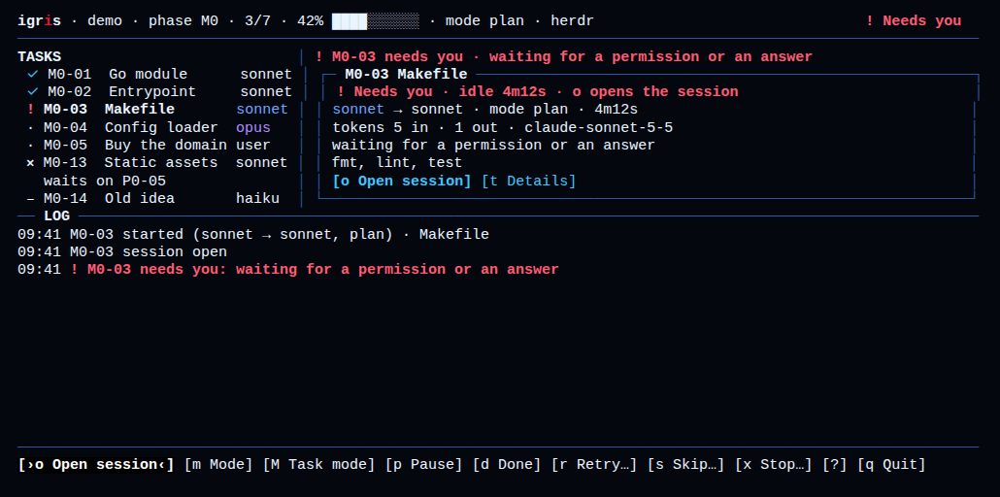
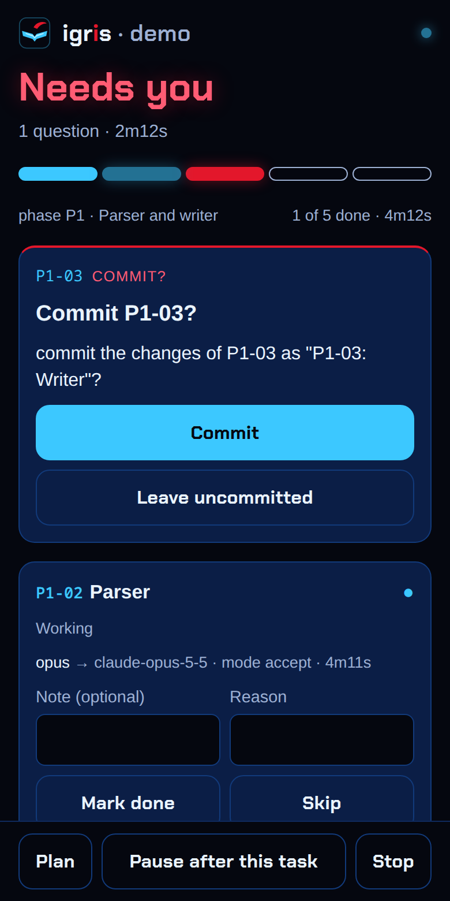

<h1 align="center">
  <picture>
    <source media="(prefers-color-scheme: dark)" srcset="docs/brand/igris-logo-dark.svg">
    
  </picture>
</h1>

<p align="center"><em>Arise.</em> One task, one fresh session, the right rank.</p>

<p align="center">
  <a href="https://github.com/drilonrecica/igris/actions/workflows/ci.yml"></a>
  <a href="https://github.com/drilonrecica/igris/releases/latest"></a>
  <a href="https://pkg.go.dev/github.com/drilonrecica/igris"></a>
  <a href="LICENSE"></a>
</p>

<p align="center"><strong><a href="https://drilonrecica.github.io/igris/">drilonrecica.github.io/igris</a></strong> · <a href="https://drilonrecica.github.io/igris/docs/">docs</a></p>

<p align="center"></p>

**igris** runs the task plan you keep in markdown through Claude Code: every task in a **fresh session**, started with **exactly the model your plan gives it**, until the phase is done.

Long Claude Code sessions fill their context and drift. Picking the model by hand for every task is tedious, and the expensive mistake is the silent one: a routine task quietly running on your most expensive model. igris takes both off your hands, and stays out of the way otherwise:

- **One task, one fresh session.** No task's context bleeds into the next. Each session gets its task, the plan and your project rules.
- **The right rank.** Your plan's Model column is the only input. igris never picks a model, never runs a Sonnet task on Opus, and tells you when a session ran on another model than its rank.
- **It waits for you.** When a session needs a decision, igris says **Needs you**, notifies your phone, and lets you answer from the terminal, the browser or the notification.
- **Deterministic.** A task is done when its session runs `igris done` and your checks pass; then igris commits, marks the plan and starts the next one. No LLM decides what runs next.

Linux and macOS (Windows through WSL2), in herdr or tmux, with your Claude Code login. igris 1.x is stable: what it keeps stable is in [`docs/compatibility.md`](docs/compatibility.md), and the full behavior is specified in [`SPEC.md`](SPEC.md).

**Contents:** [Install](#install) · [Quick start](#quick-start) · [Your plan](#your-plan) · [A run](#a-run) · [When it needs you](#when-it-needs-you) · [Beyond one task at a time](#beyond-one-task-at-a-time) · [Commands](#commands) · [Keys](#keys) · [The look](#the-look) · [Security](#security) · [Development](#development)

---

## Install

You need **Claude Code** (2.1.291 or later), logged in the way you normally use it, and **[herdr](https://herdr.dev)** (0.9.1) or **[tmux](https://github.com/tmux/tmux)** (3.2 or later), where the sessions live so they survive a closed terminal or a dropped ssh connection. git is recommended. igris starts ordinary interactive `claude` sessions, so they run on your login and its limits; if `ANTHROPIC_API_KEY` is set, Claude Code bills the API instead, and igris warns and asks first.

```sh
brew install drilonrecica/tap/igris                        # Homebrew, Linux and macOS
go install github.com/drilonrecica/igris/cmd/igris@latest  # or Go
```

Or download `igris_<version>_<os>_<arch>.tar.gz` (linux and darwin, amd64 and arm64) from [Releases](https://github.com/drilonrecica/igris/releases), [verify it](#verifying-a-download) and put `igris` on your `PATH`. Later, `igris update` updates igris the way it was installed, after asking. Shell completion, WSL2 and the herdr and tmux setup are on the site: [Install](https://drilonrecica.github.io/igris/docs/install.html).

### Verifying a download

Every release since 0.6.0 is signed with the igris release key, an SSH key that OpenSSH 8.1 or later verifies with nothing else to install:

```
igris namespaces="file,git" ssh-ed25519 AAAAC3NzaC1lZDI1NTE5AAAAIOFweVw8An9/KLs+Po4SB3jP7G/N8AkqtC67FHi48Xj+
```

It is also in [`allowed_signers`](allowed_signers), and the release tags are signed with it. Download `checksums.txt` and `checksums.txt.sig` from the release of your archive, fetch `allowed_signers` from the release's tag, check that it holds the key above, and verify:

```sh
curl -fsSLO https://raw.githubusercontent.com/drilonrecica/igris/v<version>/allowed_signers
ssh-keygen -Y verify -f allowed_signers -I igris -n file -s checksums.txt.sig < checksums.txt
sha256sum -c --ignore-missing checksums.txt    # macOS: shasum -a 256 -c --ignore-missing checksums.txt
```

The first command must print `Good "file" signature for igris`, the second `OK` for your archive. `checksums.txt` also covers each archive's SBOM. If the key is ever replaced, the new one is announced in the CHANGELOG and here, and the old one stays in `allowed_signers` with a `valid-before` date.

## Quick start

In a herdr pane or a tmux window, in your project:

```sh
igris init     # igris.toml, .igris/ (ignored in git), and the rule that lets Claude run `igris done`
igris          # the home screen
```

<p align="center"></p>

**Home** is the project at a glance: the phases and their progress, what runs next and on which rank, the plan's and the machine's health, and the last runs. Its bottom line lists what you can do from here, each with its key.

1. **No plan yet?** Home is a **GET STARTED** list that names the next step and its key (`I` does `igris init` for you, too). `E` writes the example plan or a starter template, `D` has Claude [draft one](#a-plan-from-a-goal-a-spec-or-your-issues) with you, and a plan igris can't read gets `A` to [adapt it](#different-format-igris-adapt).
2. **Look first.** `c` checks the plan, `i` runs the doctor, `v` previews the run: every task in order with its rank → model and mode, without starting anything.
3. **Arise.** `a` opens the start wizard: the phase, then the mode (**As planned**, plan, auto, accept, manual, default, and **More modes…**), then **Arise**, **Preview** or **Cancel**. The run screen opens on **Arise.**

The same from the command line: `igris check`, `igris status`, `igris arise M0 --dry-run`, then `igris arise M0`.

**The first time,** Claude Code asks whether you trust the project folder. igris can't answer that for you: after about 30 seconds the task shows `! Needs you · waiting for a permission or an answer`. Press `o` to open its session, answer once, and come back; later sessions don't ask again. The step-by-step version, with verify and commits, is the site's [Quick start](https://drilonrecica.github.io/igris/docs/quick-start.html).

## Your plan

A plan is a markdown file, `tasks.md` by default, with one task table per `##` phase:

```markdown
## M0 — Repository foundation

| ID | Task | Deps | Status | Model | Owner |
|---|---|---|---|---|---|
| M0-01 | **Go module** — init module, pin Go version | — | ready | sonnet | agent |
| M0-02 | **Entrypoint** — main.go with subcommands | M0-01 | blocked | sonnet | agent |
| M0-03 | **Crypto envelope** — versioned secret format | M0-01 | blocked | opus | agent |
| M0-04 | **Create GitHub repo** | — | ready | — | user |
| M0-G | **M0 gate** — owner smoke test | M0-01…M0-04 | blocked | sonnet | agent + user |
```

- **Model** is a rank. Like summoning the right shadow for the fight, each task gets the one your plan names: `sonnet` for routine, well-specified work, `opus` for complex or security-sensitive logic, `fable` for the highest-stakes design and correctness work. The ranks map to Claude Code's `--model` under `[models]` in `igris.toml`. A task without a usable rank is an error, never a guess.
- **Owner** is `agent`, `agent + user` (the session must get your decision or sign-off) or `user`: your own task, done outside igris, which igris waits for and you mark with `d` (done) or `s` (skip). A blocker outside the plan (keys from a client, a deploy) is a `user` task the waiting task depends on.
- **Status** is the one column igris writes; it touches nothing else in the file.
- Optional columns: **Mode** (a [mode](#when-it-needs-you) for the task), **Verify** (a verify profile), **Timeout**, **Context** (files the session must read), **Group** (tasks that never run together).

Every rule, with a larger example, is in the [plan format](docs/plan-format.md). A long plan can be [split across files](https://drilonrecica.github.io/igris/docs/split-plans.html). `igris init --example` writes a small plan, and `igris init --template go-cli` (or `web-app`, `library`) a [starter plan](https://drilonrecica.github.io/igris/docs/templates.html) with phases, gates and suggested ranks. [`examples/`](examples/) has a plan and an `igris.toml` with every key and its default.

### A plan from a goal, a spec or your issues

`igris draft` (`D` on home) has a Claude Code session write the plan with you: from a goal (it interviews you in its pane), a spec file, or an issue export (GitHub's `gh issue list --json`, Linear's or Jira's CSV). `igris draft extend` adds phases and tasks to the plan you have. Its ranks are suggestions, unsure ones left at `?`, and nothing is written until you accept it in the review. [Draft a plan](https://drilonrecica.github.io/igris/docs/draft.html).

### Different format? `igris adapt`

`igris adapt` (`A` on home) converts a plan igris can't read into this format with one session. It keeps every task, ID, dependency, status and model, invents none, and replaces your plan only once you accept the change in the review (with a backup). [Adapt a plan](https://drilonrecica.github.io/igris/docs/adapt.html).

## A run

`igris arise M0` (or `a` on home) runs phase `M0`; `--through M2` carries on through later phases, and `--only`, `--from` and `--until` run part of one. For each ready task, in plan order, igris:

1. opens a new herdr tab or tmux window and starts `claude` on the task's model and [mode](#when-it-needs-you), with igris's rules as a system prompt and the task as the first message (your own `prompt_template` can replace it);
2. watches the session through Claude Code hooks, never by scraping the screen, and reads its token usage from the transcript;
3. on `igris done M0-03`, runs your verify command; a failure goes back into the same session, and after three in a row igris calls you;
4. commits (`commit = "ask"`, `"auto"`, `"never"` or `"batch"`), marks the task `done`, unblocks what depends on it, closes the session and starts a fresh one for the next task. Under `ask`, **Commit all** commits without asking for the rest of the run; `batch` commits each task at once and asks only when the run ends whether to keep its commits (Undo is `git reset --soft`: the changes stay).

```toml
[run]
verify = "make fmt lint test"   # named profiles under [verify] for tasks that check differently
commit = "ask"
```

<p align="center"></p>

The **run screen** leads with one status word (`● Working`, `! Needs you`, `Paused`, `Done`), lists the tasks with their glyphs and ranks, and gives the running task a card: its state, rank → model and mode, tokens, the session's last lines and its buttons. When a run ends on its own, a summary takes over: the outcome, the counts, wall time, the time it waited on you, tokens, commits, and the command to run next.

- **Resume anywhere.** Quitting leaves the sessions running. `igris arise` with no phase picks up where the run left off: it reattaches the session, or offers to continue its conversation or start fresh.
- **Signals from anywhere.** `igris done ID`, `igris skip ID --reason …` and `igris reset ID` work from any terminal in the project. A session's skip or reset is only a request, which igris asks you to confirm.
- **Without the TUI,** `--no-tui` prints plain log lines and reads your answers from stdin. `--dry-run` shows the launch order and writes nothing.

### Worktree mode

`igris arise --worktree` (or `worktree = true` under `[run]`) runs the whole run in `.igris/worktrees/<run-id>` on a new branch, `igris/<run-id>`, so your checkout and your branch stay as they are; the plan's Status cells are still written in your checkout. When the run completes, igris removes the worktree, keeps the branch and tells you how to merge it, which it never does itself. It is the safe way to leave a run unattended.

## When it needs you

A session stuck on a permission prompt, a question in its pane, a plan to approve, a commit to confirm, a task past its Timeout: each turns the task to **Needs you**, the loudest thing on the screen. igris never answers Claude for you; it tells you, and you answer:

- **In the terminal.** igris's own questions (commit? a session lost? a skip request?) open a dialog over the run screen. For a question in Claude's pane, `o` jumps to the session.
- **On your phone.** A notification through a herdr or tmux toast, [ntfy](https://ntfy.sh), Discord, Slack, Gotify or a signed webhook, with quiet hours and digests. `igris notify test` sends a sample of each. [Notifications](https://drilonrecica.github.io/igris/docs/notifications.html).
- **Not for nothing.** A session that waits on its own background work (a long build, tests on a simulator) isn't stalled, and one that stops without `igris done` gets one reminder before it counts as needing you.

How much a session may do without asking is its **mode**: `plan`, `auto` (the default), `accept`, `manual` or `default`, per run (`m`, `--mode`), per task (`M`, or the plan's Mode column). In `plan` mode the session's plan opens in igris to approve or reject with feedback. Skip-permissions (`yolo`) is never one key: you type `skip permissions` on every run, and it can't be set remotely. [Modes](https://drilonrecica.github.io/igris/docs/modes.html).

## Beyond one task at a time

### Detach and attach

`igris arise` hosts the run in a background `igris serve`, so a closed terminal or a dropped ssh connection only detaches you: the run goes on. `igris attach`, or bare `igris` (home then offers **Attach** first and shows when the run needs you), opens it again from any terminal on the machine; several can be attached at once. `q` asks **Detach** · Stop run · Cancel. `igris serve` also runs headless outside herdr and tmux, and `igris stop` stops a run from a script. [Detach and attach](https://drilonrecica.github.io/igris/docs/detach-attach.html).

### Parallel phases

Mark a phase `<!-- igris:parallel -->` (the plan declares `<!-- igris:format 3 -->`) and the tasks in it that don't depend on each other run at once, two by default (`[parallel] max`, up to 8). Each works in a worktree and branch of its own with its own session and verify; a task that passes is rebased onto the run branch, verified again on the merged tree and fast-forwarded in, one commit per task, in the order they finish. A task that doesn't integrate (a rebase conflict, or verify failing on the merged tree) is run again once from the start, then **Needs you**; with `[parallel] on_conflict = "resolve"` a resolver session in its worktree gets one go at it first (on the task's rank, or `resolver_rank`), and **Resolve** on the question opens one for a single task. The run screen shows a card per active task; `[` and `]` move between them. It costs more than it looks (your limits burn N times faster, and every worktree builds cold), so start small. [Parallel phases](https://drilonrecica.github.io/igris/docs/parallel-phases.html).

### Control from your phone

<p align="center"></p>

With `[serve] http` set to this machine's Tailscale address (or loopback for `ssh -L`), serve also serves a web UI for a glance from the couch: one word for the run, a bar segmented by task, and whatever needs you in a sheet at your thumb, with its answers. Pair a device once with `igris serve token` (a URL and a QR code). From it you answer questions, approve plans, pause, stop, retry, mark done or skip, and change modes, all but skip-permissions. With `actions = true` under `[notify.ntfy]`, the ntfy message itself carries the buttons (Commit, Approve, Retry, Reset, Continue, …) and **Open**, to that task's question on the web UI; the message says what waits (`waits for a permission (Bash)`, `plan to approve`, `commit question`). The listener is off until you give it an address. [Control from your phone](https://drilonrecica.github.io/igris/docs/control-from-your-phone.html).

### Side sessions

`S`, on home or during a run, opens a Claude Code session of your own next to the run's, for a question or a look into something: blank, about the selected task, or about an igris problem, on the model and mode you pick, in the shared tree or a worktree of its own. igris doesn't watch it or count it as a task, and `igris done` refuses inside it. [Side sessions](https://drilonrecica.github.io/igris/docs/side-sessions.html).

### Usage and the rank audit

igris reads each session's token counts and model ids from its transcript (never the messages) and logs them per attempt. `igris usage` reports them by task, model and rank, for one run or since a date (`--since 7d`). The same reads check the rank: a session whose first response comes from another model than its rank resolved to (a `/model` in the pane, a setting that slipped through) is marked `▲ Rank mismatch` and **Needs you**; igris never switches it. The tokens come with an estimate, `≈ $12.40`, at the Anthropic API list prices embedded in igris (dated, never fetched, overridable per model in `[usage.prices]`); it is an estimate, not a bill, since a subscription includes this usage. `[usage.budget]` sets budgets for the run, per phase and per rank, in tokens (`"20M"`) or as an estimate (`"$40"`): one reached is **Needs you** and no new task starts until you raise it for this run, let it go on, or stop, from the terminal or the web UI; running sessions keep running, and igris never stops one or switches its model. With `[usage] statusline = true` the run screen also shows your 5-hour and 7-day subscription quota. [Usage and plan approval](https://drilonrecica.github.io/igris/docs/usage.html).

## Commands

| | |
|---|---|
| **Start** | `igris init` (`--example`, `--template NAME`) · `igris doctor` · bare `igris`: the home screen |
| **Inspect** | `igris check` (`--strict` for CI) · `phases` · `status [PHASE]` · `history [TASK-ID]` · `report [RUN]` (one run as markdown, for a PR, with where the time went: agent, verify, waiting on you) · `usage [RUN \| --since D]` |
| **Run** | `igris arise [PHASE]` · `serve [PHASE]` (`--http ADDR:PORT`) · `serve token` · `attach` · `stop` |
| **Signal** | `igris done ID` (`--note`) · `skip ID --reason …` · `reset ID` (`--force`) |
| **Plan with AI** | `igris draft goal\|spec\|import\|extend` · `adapt` |
| **Maintain** | `igris notify test` · `config migrate` · `update` · `completion bash\|zsh\|fish` · `help` · `version` |

`igris help` shows the same, and `igris COMMAND -h` a command's flags. The inspecting commands take `--json`: one versioned object each, [schemas in `docs/json/`](docs/json/), fields only ever added in 1.x. Exit codes: `0` success, `1` failure, `2` usage error. Every command and exit code is specified in [SPEC §14](SPEC.md#14-cli).

## Keys

Every action is a button with its key on it, which you can also click or tap (over ssh from a phone too), and one key means one thing on every screen. `?` lists them all.

| Key | Home | Run screen |
|---|---|---|
| `a` | Arise… (or Resume…, or Attach to a live run) | — |
| `v` `c` `i` `h` | Preview, Check, Doctor, History | `h`: History, on the summary |
| `o` | the running task's session | Open the selected task's session |
| `t` | Details of the selected phase or task | Details of the selected task |
| `m` `M` | — | run Mode, Task mode |
| `p` `d` `s` `r` `x` | — | Pause, Done…, Skip…, Retry…, Stop… |
| `[` `]` | — | previous / next card, with several active tasks |
| `S` | Side sessions | Side sessions |
| `D` `E` `I` `A` | Draft…, Plan from template…, Init, Adapt | — |
| `e` `,` `n` `u` | Edit, Settings, Notify test, Updates | — |
| `y` | copy the ID or fix command | copy `claude --resume <id>`, the log line, or the report command |
| `q` | Quit (Back on a page) | Home: asks Detach · Stop run · Cancel while the run is live |

`tab` moves between regions, the arrows (or `j`/`k`) within them, `enter` activates, `1`…`9` pick a dialog option and `esc` takes its safe choice.

## The look

igris has one design language on its three surfaces, the terminal UI, the web UI and the command line's text, written down in [`docs/design.md`](docs/design.md): seven rules, one table of glyphs (`✓` done, `●` running, `!` needs you, `·` ready, `⨯` blocked, `–` skipped, `▲` warning, `✗` failed, `◌` waiting), seven status words, and **red means you**: plume red is drawn only for Needs you and skip-permissions, and every warning is Ember. Nothing is shown by color alone, `NO_COLOR` is honored, and the colors follow a dark or light terminal (`[tui] theme` settles it).

The brand is Igris, the shadow knight: a helm with a red plume, the wordmark with its red `i`, and the night-and-glow palette. The files and the rules for using them are in [`docs/brand/`](docs/brand/README.md).

## Security

igris treats every session as untrusted. It reads `igris.toml` once per run and asks before a later run uses one a session changed; it pauses when the plan changes in a way it didn't write; it checks everything it reads back from `.igris/`; it cleans what a session wrote of escape sequences before it reaches your terminal, a notification or another pane; and it keeps your notification secrets out of verify, task hooks and git. It never sets `ANTHROPIC_API_KEY` and never reads, prints or stores your Claude credentials. The run's socket is yours alone, and the HTTP listener is off by default, paired by token, and never sets skip-permissions. igris contacts nothing but the channels you set up, and GitHub only when you ask for an update.

What it can't prevent: a session edits files, and verify runs your project's code as you. The permission mode is the real boundary, and [worktree mode](#worktree-mode) keeps a run's changes on a branch of its own. Every safety rule, with the test that enforces it, is in the [threat model](docs/threat-model.md); report a vulnerability privately as [`SECURITY.md`](SECURITY.md) describes.

## Development

Bug reports and pull requests are welcome; see [`CONTRIBUTING.md`](CONTRIBUTING.md). `make fmt lint test` is the bar for every change. Releases are built with `make release-local` (GoReleaser and syft: the four static binaries, SBOMs and checksums in `dist/`, never published by it) and signed by the maintainer; what changed is in [`CHANGELOG.md`](CHANGELOG.md). The [site](https://drilonrecica.github.io/igris/) is [`site/`](site/) plus docs pages rendered from markdown (`make site`). The GIF and screenshots above are recorded with VHS from synthetic projects (`make demo`, `make demo-screens`; see [`docs/demo/`](docs/demo/README.md)).

## License

MIT
